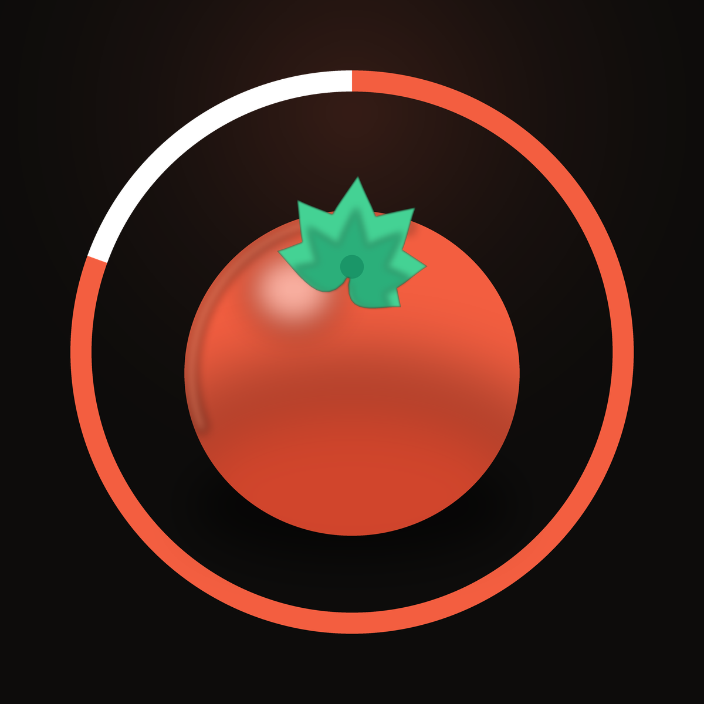

# 番茄钟

一台把注意力当仪表读数的番茄钟：专注前写清这一轮做什么，休息时看到成果，结束后沉淀成记录。

纯静态单页，无任何依赖，可离线使用，也能"添加到主屏幕"或装成安卓 App。



## 三种用法

| 用法 | 入口 | 适合 |
| --- | --- | --- |
| **安卓安装版** | `dist/tomato-clock-1.0.apk` | 想当普通 App 用：桌面图标、全屏、系统级常亮与震动 |
| 添加到主屏幕 | 手机浏览器打开网址 → 添加到主屏幕 | iPhone，或不想装 apk |
| 浏览器直接用 | 手机浏览器打开网址 | 临时用、快速体验 |

### 本地预览

```bash
cd F:\workspace\tomato-clock
py -m http.server 8777 --bind 0.0.0.0
```

手机连同一个 Wi-Fi，访问 `http://<电脑局域网IP>:8777`。

- **iPhone（Safari）**：分享 → 添加到主屏幕
- **Android（Chrome）**：右上角菜单 → 安装应用 / 添加到主屏幕

安卓安装包的详细步骤见 [dist/安装说明.md](dist/安装说明.md)。

## 设计

表盘由 **60 道真实刻度**（每 5 道一个主刻度）构成，进度弧沿刻度顺时针推进，末端带一个游标。刻度是仪表的一部分，不是装饰。

- 两套主题：**夜晚**（暖中性深底 `#0D0C0A`）与**白天**（暖白纸面 `#F7F4EE`），可在设置里切换或跟随系统
- 三种模式各有语义色，一次只出现一种：专注橙、短休息绿、长休息蓝；白天主题下文字用的强调色会压深以达标对比度，按钮填充仍用原饱和度
- 界面字体 **MiSans Regular**（内嵌子集，4221 字，549 KB，离线可用）
- 直角系统（只有表盘和圆形按钮是圆的）
- **数字仍用系统等宽字体**：MiSans 的数字是比例宽度且无 `tnum` 特性，用于倒计时会逐秒左右抖动
- 所有 token 集中在 `index.html` 的 `:root` 与 `[data-theme]`，改一处即可整体换肤

完整设计交付（画布 + 可交互原型）在 `原型/` 目录。

## 功能

### 计时

- 三种模式：专注 / 短休息 / 长休息，切模式时整页主题色渐变
- 顶部「本轮专注」任务条，一眼看到这一轮在做什么，点进去可换任务
- 组内进度：默认 4 个番茄后进入长休息，用 4 段横条显示
- 自动流转：可选"专注结束自动进入休息""休息结束自动开始下一轮"
- 键盘快捷键（桌面）：`空格` 开始 / 暂停，`R` 重置，`S` 跳过

### 任务

- 每个任务带预计番茄数与已完成数（小竖条，和表盘刻度同一语言）
- 完成当前任务自动切到下一个
- 新建任务有必填校验和同名检查

### 记录

- 今日番茄数、专注分钟、计划完成率
- 最近七天柱状图，今天用专注色高亮
- 连续专注天数，用近 14 天刻度尺呈现（今天在最右且更高）

### 可靠性

- 计时基于绝对时间戳：切后台、锁屏、关页面重开都不会走偏
- 页面关闭期间计时结束时，下次打开会补记这一次完成，不会丢番茄
- 结束提示音（Web Audio 合成，无需音频文件）+ 震动反馈
- 专注期间保持屏幕常亮（浏览器用 Wake Lock，安卓安装版走系统层）
- 离线可用：Service Worker 缓存，断网也能打开

### 数据

- 设置、任务、逐日记录都存在本机 localStorage
- 从旧版本升级时自动迁移（`longEvery` → `setSize`，`cycle` → `setDone`），记录不丢

## 设置

点右上角齿轮：

| 项目 | 默认 | 说明 |
| --- | --- | --- |
| 主题 | 跟随系统 | 跟随 / 白天 / 夜晚 |
| 专注 | 25 分 | 一个番茄的长度 |
| 短休息 | 5 分 | 每个番茄之后 |
| 长休息 | 15 分 | 完成一组之后 |
| 每组番茄 | 4 个 | 几个番茄后进入长休息 |
| 自动进入休息 | 开 | 专注结束后不用手动点 |
| 自动开始下一轮 | 关 | 休息结束后直接进入专注 |
| 提示音 | 开 | 结束时响三声 |
| 震动 | 开 | 结束时震动提醒 |

设置改动即时生效；正在运行的计时不受影响，下一轮才用新时长。

## 文件结构

```
index.html                  单页应用（结构 / 样式 / 逻辑都在这一个文件）
manifest.webmanifest        PWA 配置
sw.js                       Service Worker，离线缓存
icons/                      网页与 PWA 图标
fonts/                      内嵌字体 MiSans-Regular.woff2（子集）
tools/make_icons.py         网页图标生成脚本（Pillow）
tools/make_android_icons.py 安卓图标生成脚本

android/                    安卓原生外壳（WebView 承载上面那份页面）
  AndroidManifest.xml       清单：包名、权限、竖屏、图标
  src/.../MainActivity.java 全屏壳 + 原生桥（常亮 / 震动）
  res/                      图标与主题资源
  build.sh                  构建脚本（aapt2 → javac → d8 → apksigner）
  repack.py                 把 classes.dex 注入 APK

原型/                        设计交付
  番茄钟-无限画布.html        项目背景 + 设计系统 + 四页设计稿
  番茄钟-可交互原型.html      可点击的原型（演示数据）

dist/                       构建产物
```

## 自定义

- **改配色**：`index.html` 顶部的 `:root`，`--focus` / `--short` / `--long` 三个语义色；`[data-theme="dark"]` 与 `[data-theme="light"]` 各自覆盖底色与文字层级
- **改默认主题**：`DEFAULT_CFG.theme`，可选 `system` / `light` / `dark`
- **改默认时长**：`DEFAULT_CFG`（已被用户改过设置时不生效，因为用户设置优先）
- **重画图标**：改 `tools/make_icons.py` 的颜色常量后运行 `py tools/make_icons.py`，安卓图标再跑 `py tools/make_android_icons.py`
- **重新打包 apk**：改完页面后运行 `bash android/build.sh`
- **换字体**：把新的 woff2 放到 `fonts/`，改 `index.html` 里的 `@font-face` 与 `--font-ui`；字形子集需覆盖页面用字，否则缺字会回退

## 构建 APK

需要 JDK 17 与 Android build-tools（`aapt2` / `d8` / `zipalign` / `apksigner`）：

```bash
JAVA_HOME=/path/to/jdk17 ANDROID_SDK=/path/to/android-sdk bash android/build.sh
```

脚本不依赖 Gradle，输出 `dist/tomato-clock-<version>.apk`。

**签名密钥**：首次构建会自动生成 `android/signing/tomato.keystore` 并随机生成口令存到同目录的 `password.txt`。这两个文件都不会提交。

换机器构建时，把这两个文件一起带过去，否则新包无法覆盖安装旧包、必须先卸载（会清掉本地数据）。也可以用 `TOMATO_KS_PASS` 环境变量指定口令。

## 字体授权

界面使用小米 MiSans（官方 npm 包 `misans`，Apache-2.0），只保留页面实际需要的字形并转换为 woff2 以控制体积。

自己使用没有问题；如果要把 APK 分发给他人，建议先确认 MiSans 的商用与再分发条款。

## 已知限制

- 提示音需要用户先点一次「开始」才会解锁播放（iOS / Android 的自动播放限制）
- 浏览器里震动依赖 `navigator.vibrate`，iOS Safari 不支持会静默跳过；**安卓安装版走原生震动，不受此限制**
- 屏幕常亮在浏览器里依赖 Wake Lock API，iOS Safari 支持有限；**安卓安装版由系统层保证**
- 多个浏览器标签页同时打开时，计时状态会互相覆盖。同一时间只在一个标签页里用
- 连续天数按"有完成番茄的日子"计算，中断一天即归零
